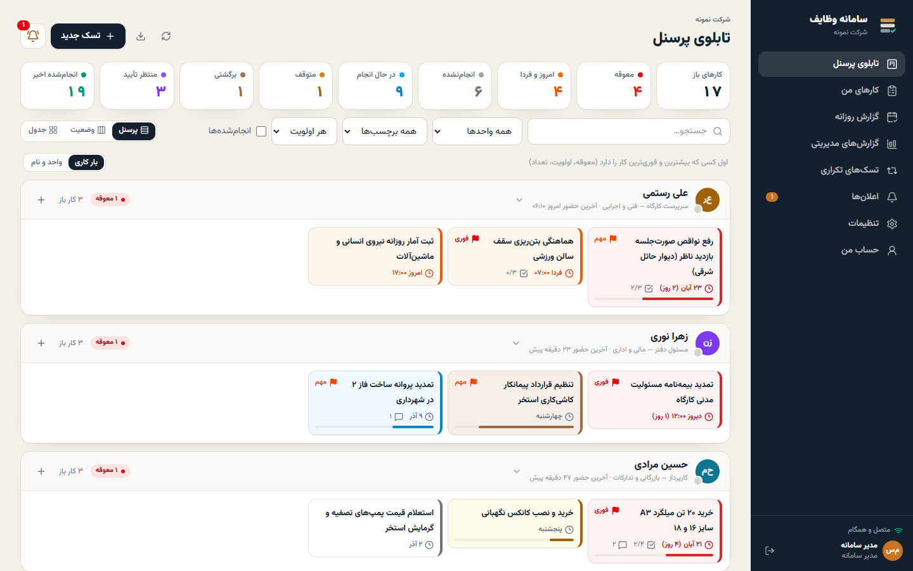
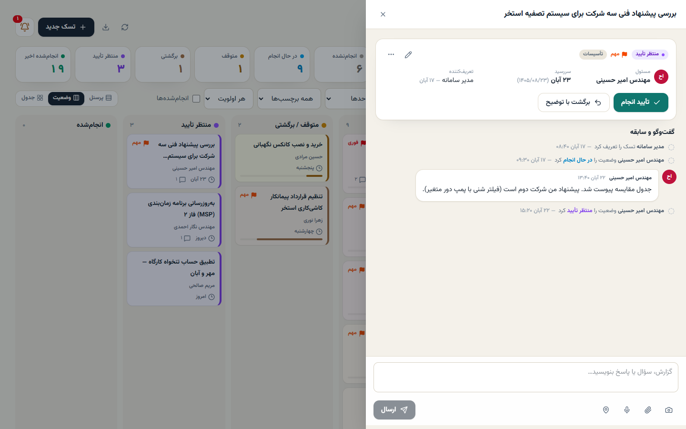
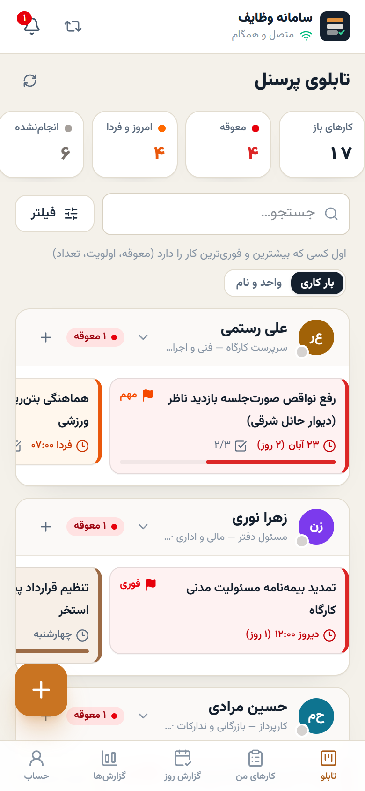
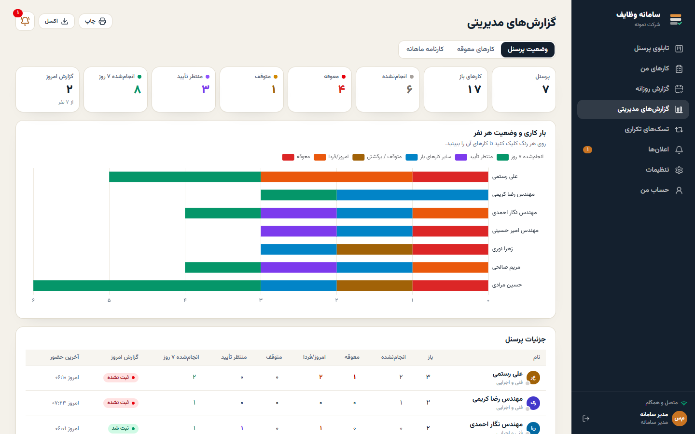
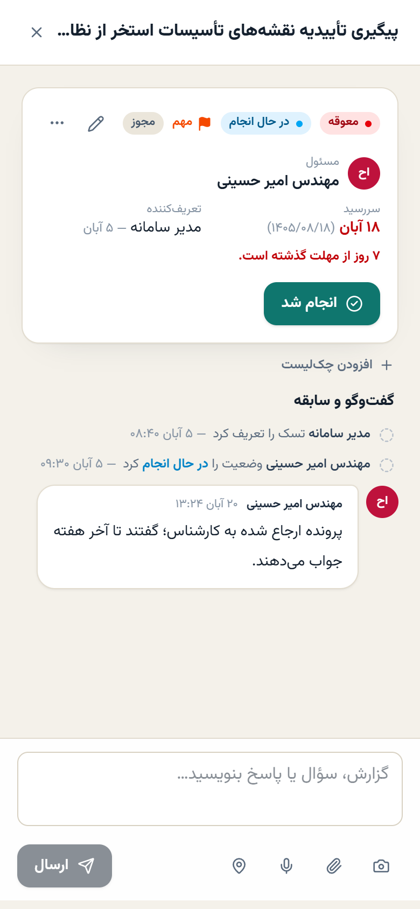
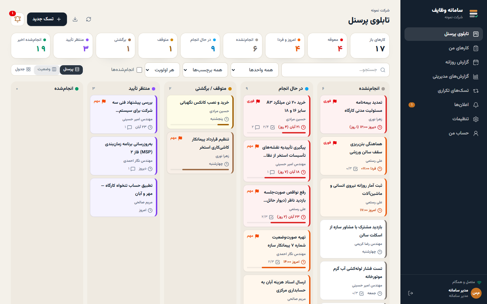
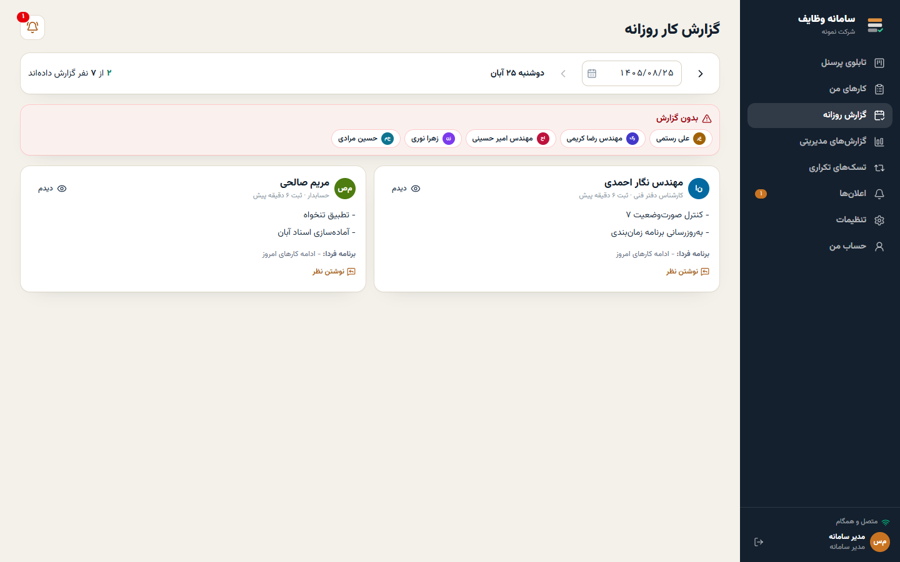

# Vazifeh (وظیفه)

A self-hosted, Persian-first (RTL) team task manager for small companies and field teams.
One Node.js server, one SQLite file, and clients for the web, Windows desktop and Android.

> **وظیفه** یک سامانه متن‌باز مدیریت وظایف و گزارش کار تیمی است؛ کاملاً فارسی و راست‌به‌چپ، با تقویم شمسی،
> قابل نصب روی سرور خودتان یا حتی یک کامپیوتر در شبکه شرکت. راهنمای فارسی: [راهنما.md](راهنما.md)



<table>
  <tr>
    <td width="68%"></td>
    <td></td>
  </tr>
  <tr>
    <td></td>
    <td></td>
  </tr>
</table>

<details>
<summary>More screenshots</summary>

**Status columns view**


**Daily work reports**


</details>

All names and tasks in the screenshots are the built-in demo data.

## Download

Ready-made builds are on the [Releases](https://github.com/aghasizade/vazifeh/releases) page:
the Windows installer and the Android APK. Both connect to a Vazifeh server you run yourself (see Quick start).

## Why

Most task tools are built for English, the Gregorian calendar and always-on internet. Teams in Iran and other
Persian-speaking places need right-to-left UI, Jalali dates and local holidays, data that stays on their own
server, and an Android app that keeps working on a construction site with a weak connection. Vazifeh does that
without any third-party service.

## Features

- **Board at a glance:** every person's open tasks colour-coded by status (to do, doing, due soon, overdue,
  waiting for approval, done, blocked, returned), plus people / status-column / table views.
- **Roles:** CEO, system admin, department supervisor and employee, each seeing only what they should.
- **Task workflow:** assign, start, block with a reason, finish, approve or return with a note; checklists,
  priorities, tags and progress.
- **Rich updates:** chat on each task with photos, documents, voice notes (playback at 1.5×/2× keeps pitch)
  and location; read receipts.
- **Recurring tasks** and personal tasks.
- **Daily reports** with a reminder at a set hour, and a morning digest for managers.
- **Reports and Excel export:** per-person scorecards and trends.
- **Jalali calendar** throughout, with work days and holidays configurable.
- **Live updates** over Server-Sent Events, reconnecting after Wi-Fi/mobile/VPN switches.
- **Offline mode on phones:** the last task list stays readable, and messages, photos, status changes and daily
  reports queue in an outbox that sends itself when the connection returns.
- **Notifications:** instant while open; on Android a background worker checks every ~15 minutes; on Windows
  the app sits in the tray.
- **In-app updates** for Android (APK download with size and package checks) and the desktop shell.
- **Daily backups** and a one-click database download for admins.
- **Demo data** (seven fictional employees, three months of history) that can be loaded and removed in one click.

## Stack

- Server: Node.js (≥ 22.13, built-in `node:sqlite`), Express 5, ExcelJS
- Web UI: React 19, Vite, Tailwind CSS 4, ECharts, Vazirmatn font
- Desktop: Electron (Windows installer via electron-builder)
- Android: Capacitor 8 with a small native plugin (battery-saver exemption, background notifications, APK updates)

## Quick start

```bash
npm install
npm run build
npm run server
```

Open `http://localhost:8090`. The first start creates `admin` / `admin` and asks you to change the password.
Data lives in `.data/` (set `TASKS_DATA` to move it, `PORT` to change the port).

For development with hot reload, run `npm run server` and `npm run dev` side by side.

## Deploying on a Linux server

On Ubuntu 24.04 with a domain pointing at the server:

```bash
sudo bash deploy/install.sh tasks.example.com
```

This installs Node.js, nginx and an HTTPS certificate, and runs the server as a systemd service with data in
`/var/lib/vazifeh`. Update later with `sudo bash deploy/update.sh`.

## Desktop and Android clients

- Windows: `npm run dist` builds the installer in `build-output/`.
- Android: `npm run apk` (see `scripts/build-apk.ps1`; needs the Android SDK and your own signing key in
  `android/keystore.properties`).

Both ask for the server address on first launch.

## Contributing

Issues and pull requests are welcome, in Persian or English. Please keep the UI text Persian and right-to-left.

## License

[MIT](LICENSE)
